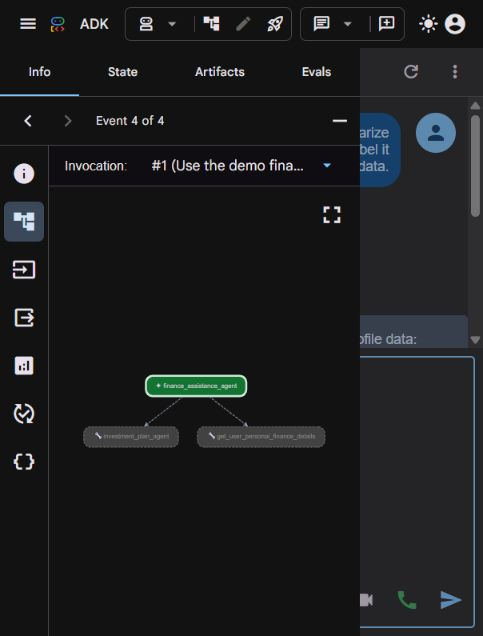

# ADK Finance Assistant

An educational finance assistant built with Google's Agent Development Kit
(ADK), OpenAI `gpt-4o-mini`, and two cooperating agents. It explains finance
concepts, analyzes a clearly labeled demo budget, and finds public sources for
investment research.

[](https://github.com/harshgavandit/adk-finance-assistant/actions/workflows/tests.yml)

The application runs locally through the ADK web UI or command line. It needs
one OpenAI API key. Local SQLite rate limiting requires no Redis service.

The repository also includes a Vercel-compatible FastAPI web adapter with a
responsive chat page and private access-code protection. The existing ADK CLI
and development UI remain available for local use.

## Hosted web app

**Live demo: [adk-finance-assistant.vercel.app](https://adk-finance-assistant.vercel.app)**

The public landing page explains the sample budget. Chat requires a private
access code; the OpenAI API key is used only by the server and is never sent to
the browser. The access code and conversation remain in the current tab's
memory. Refreshing or starting a new chat clears the conversation. Each request
reconstructs a temporary ADK session from the bounded browser history, so
conversation continuity does not depend on reaching the same Vercel instance.

Vercel uses `main.py`, root `requirements.txt`, `.python-version` and
`vercel.json`. The `public/` directory serves the frontend. The chat API accepts
at most 2,000 characters per message and 12 previous messages (18,000 total
history characters). Requests time out rather than hanging indefinitely.

Private Vercel environment variables:

```dotenv
OPENAI_API_KEY=your_openai_api_key_here
LLM_MODEL=gpt-4o-mini
APP_ACCESS_CODE=your_private_random_access_code
LITELLM_LOCAL_MODEL_COST_MAP=True
RATE_LIMIT_MAX_CALLS=20
RATE_LIMIT_WINDOW_SECONDS=60
```

The hosted limiter uses writable temporary storage and applies per Vercel
instance. It resets on cold starts and is **not a global spending cap**.
Distribute the access code only to intended demo users. The app does not have
account registration or an authenticated banking integration.

To run the hosted adapter locally, set `APP_ACCESS_CODE` in the process
environment, activate the repository's virtual environment and run
`python -m uvicorn main:app --host 127.0.0.1 --port 8001` from the repository
root. For local deployment credentials, `.env.deployment` is ignored by Git.
The adapter deliberately does not expose ADK's development/admin endpoints.



## Features

- **Finance explanations:** ask about recurring deposits, budgeting, expenses,
  and savings goals using the configured OpenAI model.
- **Tool-based demo budgeting:** the finance tool returns sample monthly INR
  income of ₹50,000, expenses of ₹40,000, and savings of ₹10,000. The assistant
  identifies this as sample data, rather than claiming access to your accounts.
- **Investment agent:** the root agent delegates current-information questions
  to a specialist with public web search through DDGS.
- **Source provenance:** search results include source URLs and an actual UTC
  retrieval timestamp. After search, a deterministic callback returns source
  links instead of generated numeric rates, prices, or active-scheme claims.
- **Shared local quota:** an atomic fixed-window limiter admits 20 OpenAI model
  calls per 60 seconds by default, shared across both agents and local processes.
- **Configuration and diagnostics:** project-relative `.env` loading, positive
  numeric validation, timeouts, output-token limits, and sanitized error messages.
- **Repeatable verification:** regression tests, an offline check, optional live
  workflows, and GitHub Actions checks that need no real API credentials.

## Architecture

```text
ADK web UI / CLI
       |
       v
Finance assistant (gpt-4o-mini)
       |
       +--> Demo finance profile tool
       |
       +--> Investment planning agent (gpt-4o-mini)
                    |
                    +--> Public web search (DDGS)
                              |
                              +--> Source links + retrieval timestamp

Every model call from either agent:
    Shared SQLite admission --> OpenAI API
```

Both agents use ADK's `LiteLlm(model="openai/gpt-4o-mini")` connector. The model
name comes from `LLM_MODEL`; there is no hard-coded Gemini dependency in the
runnable agents. The original Gemini tutorial is preserved separately for
learning and attribution.

## Quick start on Windows

Prerequisites: Git, Python 3.14, PowerShell, internet access, and an OpenAI API
key with model access and available API quota. The local workflow was verified
with Python 3.14.6. The CI workflow exercises Python 3.14 on Windows and Linux.

```powershell
git clone https://github.com/harshgavandit/adk-finance-assistant.git
cd adk-finance-assistant

New-Item -ItemType Directory -Force .tmp | Out-Null
$env:TEMP = Join-Path $PWD '.tmp'
$env:TMP = $env:TEMP
python -m venv .venv
.\.venv\Scripts\python.exe -m pip install -r .\ADK_Finance_Assistance_Agent\requirements-dev.txt

Copy-Item .\ADK_Finance_Assistance_Agent\.env.example .\ADK_Finance_Assistance_Agent\.env
```

Edit `ADK_Finance_Assistance_Agent/.env` locally and replace the placeholder:

```dotenv
OPENAI_API_KEY=your_openai_api_key_here
LLM_MODEL=gpt-4o-mini
```

Start the application:

```powershell
cd .\ADK_Finance_Assistance_Agent
.\run.ps1 -Mode web -Port 8001
```

Open [http://127.0.0.1:8001](http://127.0.0.1:8001) and select
`finance_assistant_agent`. Stop the server with Ctrl+C in its terminal. ADK
disables automatic reload on Windows; restart after changing code or `.env`.
Use a different port if the chosen one is occupied.

If local PowerShell policy blocks scripts, run the equivalent Python command:

```powershell
$env:PYTHONUTF8 = '1'
$env:LITELLM_LOCAL_MODEL_COST_MAP = 'True'
..\.venv\Scripts\python.exe -m google.adk.cli web --host 127.0.0.1 --port 8001 .
```

## macOS / Linux

From the cloned repository root:

```bash
python3 -m venv .venv
source .venv/bin/activate
python -m pip install -r ADK_Finance_Assistance_Agent/requirements-dev.txt
cp ADK_Finance_Assistance_Agent/.env.example ADK_Finance_Assistance_Agent/.env
# Edit .env and supply your own OpenAI API key.
cd ADK_Finance_Assistance_Agent
export PYTHONUTF8=1
export LITELLM_LOCAL_MODEL_COST_MAP=True
python -m google.adk.cli web --host 127.0.0.1 --port 8001 .
```

## Configuration

The settings loader finds `.env` beside the application's README regardless of
the caller's working directory. Existing process environment values override
the file. Neither a Google API key nor Redis credentials are required.

| Variable | Default | Purpose |
| --- | --- | --- |
| `OPENAI_API_KEY` | Required | OpenAI API credential; keep local |
| `LLM_MODEL` | `gpt-4o-mini` | OpenAI model for both agents |
| `RATE_LIMIT_MAX_CALLS` | `20` | Admitted model calls per window |
| `RATE_LIMIT_WINDOW_SECONDS` | `60` | Fixed-window duration |
| `RATE_LIMIT_DB` | `.runtime/rate_limit.sqlite3` | Shared local quota database, relative to the app directory |
| `LLM_TIMEOUT_SECONDS` | `45` | Provider request timeout |
| `LLM_MAX_OUTPUT_TOKENS` | `1500` | Maximum generated output tokens |
| `SEARCH_TIMEOUT_SECONDS` | `15` | Public search timeout |
| `SEARCH_MAX_RESULTS` | `5` | Search result limit, capped at 10 |

All numeric values must be positive integers. Provider retries are disabled so
one admitted request does not silently make repeated paid attempts. OpenAI
charges apply to model requests, including optional live verification.

## Try these prompts

1. `Explain a recurring deposit in two sentences.`
2. `Use the demo finance profile tool and summarize income, expenses and savings.`
3. `Using the demo profile, suggest how to increase monthly savings to ₹15,000.`
4. `Ask the investment agent to search for official SBI fixed-deposit rate sources.`

Ask budget-planning questions separately from current-source requests. A query
that triggers public search ends with a deterministic source list and a
verification notice; it does not return calculated current-rate advice.

## Verification

From the application directory on Windows:

```powershell
.\run.ps1 -Mode check
.\run.ps1 -Mode test
.\run.ps1 -Mode cli
# Optional: billable model requests and public searches.
.\run.ps1 -Mode live
```

Portable equivalents, with the virtual environment activated:

```bash
python -m pip check
python -m pytest -q
python verify.py --output verification/offline.json
python verify.py --live --output verification/live.json
python -m google.adk.cli run finance_assistant_agent
```

The regression suite does not contact OpenAI or search engines. It covers:

- configuration validation and secret-safe representations;
- exactly three admissions from 20 concurrent attempts at a limit of three;
- shared admission across a second process and expiry without extending denial;
- blocking calls when storage is unavailable;
- both agent configurations and consistent demo-budget values;
- sanitized model errors and search failure behavior;
- source provenance and deterministic responses that replace invented rates/dates;
- an actual ADK runner whose model must never be contacted when quota is exhausted.

The recorded local verification on **14 October 2026** passed all **12 tests**,
dependency compatibility, offline checks, and live OpenAI workflows. Live
evidence includes general generation, the finance-profile tool, investment
delegation, and public search. Browser testing confirmed the profile tool and
rendered demo-budget response through ADK's chat UI. These are point-in-time
local checks; external service availability and search results can change.

- [Live verification report](ADK_Finance_Assistance_Agent/verification/live.json)
- [Offline verification report](ADK_Finance_Assistance_Agent/verification/offline.json)
- [Browser evidence](ADK_Finance_Assistance_Agent/verification/browser-budget.png)
- [Verification notes](ADK_Finance_Assistance_Agent/verification/README.md)

CI runs dependency checks, tests, syntax compilation, offline verification, and
a credential-pattern scan using a dummy API key. It never runs the billable
live verifier.

## Rate-limit behavior

The limiter counts **model calls, not chat messages**. A single conversation
turn can consume multiple slots as agents call tools and summarize their
results. Both agents share the configured API key's quota through the same
SQLite file; only a SHA-256 key fingerprint and quota metadata are stored there.

Admission uses a SQLite write transaction, so concurrent callers cannot exceed
the configured limit. Denied attempts do not extend the window. An admitted
call consumes a slot even if OpenAI later fails. Denial is returned as an ADK
chat message with retry timing, and storage errors block model calls.

This protects processes on one computer sharing a database. It does not provide
Redis-based admission across hosts or replace OpenAI account-level limits.
The ADK callback returns a chat message rather than an HTTP 429 status.

## Scope and limitations

- This is an educational local application. There is no banking connection,
  authenticated financial-profile database, or production user-authentication layer.
- The hard-coded finance profile is demo data. User-supplied figures should take
  precedence in planning, but they are not persisted by the profile tool.
- Public search retrieves snippets, not verified live market feeds or full bank
  rate tables. Exact current values require checking the linked source pages.
- Search queries go to external search engines. The agents are instructed to
  keep queries public and exclude personal financial information.
- ADK's local web UI persists chat sessions and artifacts in ignored `.adk`
  folders. Prompts sent to OpenAI are processed by the configured API provider.
- The server binds to `127.0.0.1`. Public deployment, access control, multi-host
  rate limiting, and load testing are outside the verified scope.

## Repository structure

```text
.
├── README.md
├── .gitignore
├── .github/workflows/tests.yml
├── scripts/check_publishable.py
└── ADK_Finance_Assistance_Agent/
    ├── finance_assistant_agent/       # Root agent + demo profile tool
    ├── investment_plan_agent/         # Specialist with public search
    ├── finance_runtime/               # Settings, model callbacks, limiter, search
    ├── tests/                         # Offline regression suite
    ├── verification/                  # Reports and browser evidence
    ├── docs/                          # Original Gemini tutorial
    ├── DOCUMENTATION.pdf              # Original learning reference
    ├── .env.example
    ├── requirements.txt
    ├── requirements-dev.txt
    ├── run.ps1
    └── verify.py
```

Only `.env.example` is public. `.env`, local credentials, virtual environments,
session databases, rate-limit databases, caches, and extraction metadata are
excluded from version control.

## Troubleshooting

| Symptom | Check |
| --- | --- |
| Missing configuration | Create the app's `.env` from `.env.example` and set `OPENAI_API_KEY` |
| Authentication failed | Verify the OpenAI API key and its project |
| Quota unavailable | Check OpenAI API billing and project usage limits |
| Model unavailable | Verify `LLM_MODEL` and your API project's model access |
| Local rate limit reached | Wait for the displayed retry interval; tool follow-ups also consume slots |
| Local limiter unavailable | Check that `.runtime` is writable and that `RATE_LIMIT_DB` is valid |
| Search unavailable | Check internet/search-engine access; the assistant cannot verify current data |
| Address already in use | Choose another port, such as `-Port 8001` |
| Windows virtual-environment setup fails | Use a writable `.tmp` for `TEMP` and `TMP` as shown above |
| Agent changes are not visible | Restart the Windows ADK web server |

## Learning references and attribution

The source archive included a beginner tutorial and documentation PDF about a
Gemini-based Google ADK finance assistant. They are retained as historical
learning references; their model/provider instructions differ from this
repository's runnable OpenAI implementation.

- [Original Gemini tutorial](ADK_Finance_Assistance_Agent/docs/ORIGINAL_GEMINI_TUTORIAL.md)
- [Original documentation PDF](ADK_Finance_Assistance_Agent/DOCUMENTATION.pdf)
- [Original tutorial video](https://youtu.be/OA6y5JoEjGs)
- [Google ADK documentation](https://adk.dev/)
- [ADK LiteLLM integration](https://adk.dev/agents/models/litellm/)
- [OpenAI GPT-4o mini documentation](https://developers.openai.com/api/docs/models/gpt-4o-mini)
- [DDGS project](https://github.com/deedy5/ddgs)

No new license grant is added here. The original tutorial describes educational
use, but the source archive did not include a standalone license file.
